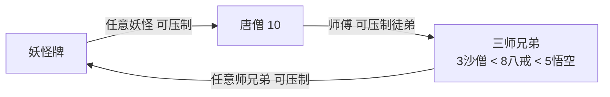
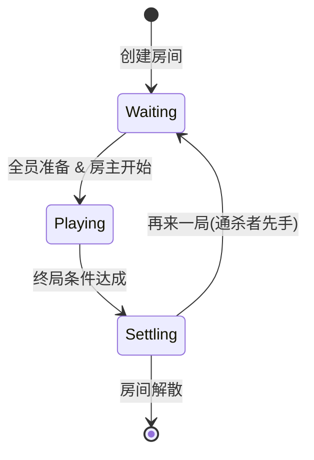
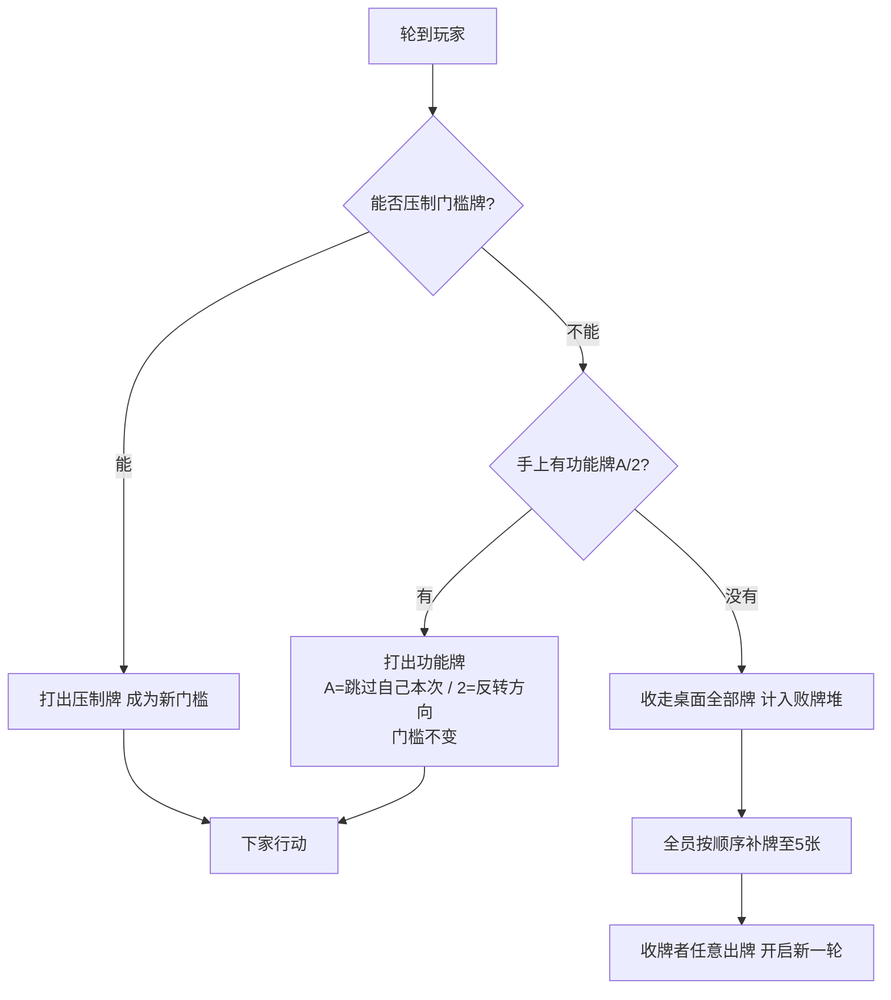

# 《西游斗牌》游戏设计文档

> **版本**: v0.2 ｜ **日期**: 2026-10-11 ｜ **状态**: 核心规则已确认，细节待定（见 §10）
>
> 标记说明：✅ = 已确认规则；⚠️ = 建议默认值（可调整，确认后转正）。
> 本文档是游戏规则与设计的唯一记录处，后续规则变更请在 §12 版本记录 中登记。

---

## 1. 游戏概述

| 项目 | 内容 |
|---|---|
| 游戏名称（暂定） | 西游斗牌 |
| 支持人数 | 3 ~ 6 人 |
| 牌具 | 标准扑克牌一副（54 张，含大小王） |
| 游戏类型 | 房间制多人回合游戏 · 环形克制出牌 · 收牌惩罚 · 计牌制胜负 |
| 题材 | 西游记（唐僧师徒四人西天取经，一路降妖除魔） |

一句话简介：场上牌分为**妖怪牌**与**取经人牌**，构成「妖怪 → 唐僧 → 三师兄弟 → 妖怪」的环形克制关系；轮到自己必须压制场上门槛牌或打出功能牌，**既压不住又没有功能牌的人收走桌面全部牌作为败牌**；摸牌堆打完后统计，**败牌最少者通杀获胜**。

## 2. 房间与对局流程（已确认 ✅）

1. 玩家创建或加入房间，人数 3~6 人
2. 玩家点击「准备」，**所有玩家准备完毕后**，房主点击「开始游戏」
3. 发牌：每名玩家初始获得 **5 张手牌**，其余牌作为摸牌堆
4. 先手规则：
   - 首局：**房主先出牌**
   - 非首局：**上一局的赢家（通杀者）先出牌**
   - 出牌顺序默认**顺时针**（座位号递增方向）
5. 本局结束后回到准备状态，可再开下一局

### 2.1 术语定义 ⚠️

| 术语 | 定义 |
|---|---|
| 局（Game） | 从发牌到终局结算的完整过程 |
| 轮（Trick） | 从某人出牌开始，到下一次收牌为止的一段 |
| 回合（Turn） | 单个玩家的一次行动机会 |
| 门槛牌 | 桌面上最后一张参与压制的牌（功能牌不改变门槛） |
| 败牌堆 | 玩家因收牌获得的牌，即失败记录，之后不再参与游戏 |
| 通杀 | 一局结算时败牌最少的玩家，即本局赢家 |

发牌后摸牌堆余量：

| 人数 | 手牌总数 | 摸牌堆余量 |
|---|---|---|
| 3 | 15 | 39 |
| 4 | 20 | 34 |
| 5 | 25 | 29 |
| 6 | 30 | 24 |

## 3. 牌型定义与克制关系

### 3.1 取经人牌 / 角色牌（已确认 ✅）

| 牌面 | 角色 | 身份 | 数量 |
|---|---|---|---|
| 数字 3 | 沙僧 | 三师弟 | 4 张 |
| 数字 5 | 孙悟空 | 大师兄 | 4 张 |
| 数字 8 | 猪八戒 | 二师兄 | 4 张 |
| 数字 10 | 唐僧 | 师傅 | 4 张 |

> 彩蛋备注：3 = 三师弟；5 = 五行山下五百年；8 = 八戒；10 = 十世修行（唐僧为十世修行的好人）。

### 3.2 妖怪牌（已确认 ✅）

其余牌均为「妖怪牌」（取经路上的妖魔鬼怪，小王 / 大王为妖王之首）：

```
4 < 6 < 7 < 9 < J < Q < K < 小王 < 大王
```

数量：以上每个牌面 4 张，小王、大王各 1 张。

### 3.3 功能牌（已确认 ✅）

| 牌面 | 效果 | 数量 |
|---|---|---|
| A | 跳过自己本次出牌 | 4 张 |
| 2 | 反转出牌顺序：由刚刚的上家出牌；之后维持反转后的顺序，直到出现下一个 2 再次反转 | 4 张 |

### 3.4 环形克制关系（核心 ✅）

一物降一物，构成循环：



- 三师兄弟都有战斗力，**任意一张**（哪怕是沙僧 3）都可压制**任意**妖怪牌
- 三师兄弟内部比大小：**3（沙僧）< 8（八戒）< 5（悟空）**，大压小
- 唐僧是师傅，可压制三名徒弟；但手无缚鸡之力，**压制不了妖怪，反被任意妖怪压制**
- 妖怪牌内部比大小：**4 < 6 < 7 < 9 < J < Q < K < 小王 < 大王**，大压小

### 3.5 压制速查表（核心 ✅）

| 场上门槛牌 | 可以压制它的牌 |
|---|---|
| 妖怪牌（任一） | ① 牌值更大的妖怪牌 ② 任意三师兄弟（3 / 8 / 5） |
| 3 沙僧 | 8 八戒、5 悟空、10 唐僧 |
| 8 八戒 | 5 悟空、10 唐僧 |
| 5 悟空 | 10 唐僧 |
| 10 唐僧 | 任意妖怪牌（不论大小） |

> ⚠️ 同牌值不互压（如 10 压不了 10、4 压不了 4），必须严格更大 —— 待确认（§10 Q1）。

### 3.6 全牌构成汇总（54 张）

| 类别 | 牌面 | 张数 |
|---|---|---|
| 取经人牌 | 3、5、8、10 | 16 |
| 功能牌 | A（跳过）、2（反转） | 8 |
| 妖怪牌 | 4、6、7、9、J、Q、K、小王、大王 | 30 |
| **合计** | — | **54** |

## 4. 核心出牌机制（已确认 ✅）

1. 轮到自己时，必须完成以下**之一**：
   - **压制**：打出一张能压制当前门槛牌的手牌（见 §3.5 速查表），该牌成为新门槛
   - **功能牌**：打出 A 或 2（不受门槛限制）✅
2. **收牌（惩罚）**：若手牌中既没有能压制的牌、也没有功能牌，必须**收走桌面全部已出的牌**，放入自己的**败牌堆**（失败记录，之后不再使用）✅
3. **补牌**：收牌后，所有玩家按出牌顺序依次从摸牌堆**补齐至 5 张**（摸牌堆不足则摸完为止）✅
4. **新一轮**：由**收牌者**（本轮最先无法出牌的人）先出牌；桌面已清空，可出**任意一张牌**作为新门槛 ✅
5. 本游戏**没有回合摸牌**：手牌只通过「收牌后的统一补牌」恢复 ⚠️ 默认设定
6. **出完手牌不直接获胜**（区别于 UNO 类游戏）：空手玩家轮空，等待补牌或终局 ✅
7. 能压制时是否可主动改打功能牌：⚠️ 建议允许（战术性让过 / 反转），见 §10 Q2
8. **多张同点出牌（组合压制）✅ v1.1**：可一次打出 **2~4 张同点牌** 组成组合
   - **开局（桌面为空）**：可出任意 2~4 张同点牌作为新门槛
   - **压制**：组合必须与当前门槛**张数相等**（3 张小妖须 3 张更大的同点妖怪 / 3 张师兄弟 / 唐僧压 3 张师兄弟，依此类推）；单张门槛只能用单张压，2 张门槛只能用 2 张同点压
   - **同点判定**：组合内所有牌牌值（rank）相同；不同牌值不可混出
   - **克制判定**：组合整体复用 §3.4 环形克制（组内同点，只需比对牌值大小）
   - **功能牌 A/2 只能单张打出**，不参与组合
   - 桌面门槛牌展示时标注 ×N 张数

> 设计意图：压制链是「妖怪 → 唐僧 → 师兄弟 → 妖怪」的一物降一物；收牌是唯一惩罚，牌局通过收牌不断「洗牌重来」，压制得越准的人败牌越少；多张同点组合让同点攒牌有压制价值，节奏更快。

## 5. 角色技能（已确认 ✅ v1 不带技能）

- 四张角色牌 v1 仅参与克制比大小，**不带技能**；角色身份用于展示与后续拓展
- 技能系统作为拓展接口预留（示例方向，待后续版本设计）：沙僧「流沙河」重置门槛、悟空「筋斗云」压制后立即再行动、八戒 / 唐僧技能待设计

## 6. 功能牌细则

### 6.1 A「跳过」（已确认 ✅）

- 轮到自己时可打出：**跳过自己本次出牌**，直接轮到下家；当前门槛牌不变
- 定位：压不住时的「救命牌」（避免收牌），也可在能压制时主动使用（战术性让过）
- ⚠️ A 打出后置于弃牌区，不进入压制链；若之后有人收牌，A 一并被收走

### 6.2 2「反转」（已确认 ✅）

- 轮到自己时可打出：出牌方向**立即反转**，下家改为「刚刚的上家」；此后维持新方向，直到下一个 2 再次反转
- 门槛牌不变：反转后由上家面对原门槛牌
- 连续两个 2 = 方向反转两次 = 回到原方向
- 3 人局中反转等效「跳过」第三人一轮（由正常规则自然产生，无需特判）

### 6.3 边界情况（⚠️ 建议）

| 情况 | 处理规则 |
|---|---|
| 一轮的第一张牌（桌面为空） | 可出任意牌（含功能牌）；此时 2 仅反转方向，A 视为白打一张 |
| 同牌值是否可压 | ⚠️ 建议：不可，必须严格更大（§10 Q1） |
| 收牌范围 | ⚠️ 建议：桌面全部已出牌，含功能牌（§10 Q5） |
| 补牌顺序 | ⚠️ 建议：从收牌者开始，按当前出牌方向依次补至 5 张（§10 Q6） |
| 摸牌堆不足 | 摸完为止，补不满 5 张的玩家保持现有手牌 |
| 手牌为空的玩家 | 轮空，等待下次收牌后的补牌 |
| 玩家中途掉线 | 托管：超时自动「收牌」或自动出最小可压牌（§9、§10 Q8） |

## 7. 终局与胜负（核心已确认 ✅）

1. **终局**：摸牌堆打完后 ⚠️ 建议继续用手牌打完当前局面，当**再次发生收牌**（且无法补牌）或**所有玩家手牌出完**时，本局结束（备选方案见 §10 Q3）
2. **结算**：统计各玩家败牌堆数量，**败牌最少者通杀**，获得本局胜利 ✅
3. **局间**：回到准备状态，可再开下一局；**上局通杀者先出**，首局房主先出 ✅
4. 玩家手中剩余的牌、桌面遗留未收走的牌：⚠️ 建议**不计入**败牌，仅统计败牌堆（§10 Q4）
5. 拓展预留：连赢 N 局制、积分制、败牌计分（如王算多分）

## 8. 流程图

房间级状态机：



> Waiting=等待准备 ｜ Playing=对局中 ｜ Settling=结算（统计败牌）

单个回合决策流：



克制关系图见 §3.4。若查看器不支持 mermaid，以文字规则为准。

## 9. 技术实现（已落地 ✅，v1.0 代码实现）

- **技术形态**：Web 应用（H5 单页 + Node.js 服务端），局域网内手机/电脑浏览器通过 `http://电脑IP:3000` 访问联机
- **技术栈**：Node.js LTS + Express（静态托管）+ Socket.IO（实时通信）+ 原生 HTML/CSS/JS 前端（零构建工具）；测试用 Node 内置 `node:test`
- **架构分层**：
  - `lib/cards.js` 纯函数层：牌定义、组内序数、环形克制判定 `canBeat(top, card)`、洗牌、发牌
  - `lib/engine.js` 规则引擎（无 I/O）：房间状态机（waiting→playing→settling）、回合流转、收牌/补牌/终局/托管选择
  - `net/net.js` 协议层：Socket.IO 事件接入、按人定制 state 广播（防作弊，只下发本人手牌）、掉线托管与重连
  - `server.js` 进程入口：静态服务、局域网 IP 打印、防火墙提示
- **关键事件协议（客户端 ⇄ 服务端）**：`createRoom`、`joinRoom`、`rejoin`、`leaveRoom`、`ready`、`start`、`playCard`、`pickUp`、`nextRound`；服务端下发 `roomJoined`、`state`（全量按人定制）、`yourTurn`（含合法出牌集合）、`gameEnd`、`error`、`roomClosed`
- **同步策略**：每次状态变更后全量、按人定制广播（状态体积极小，无增量同步 bug）
- **托管**：轮到自己 30s 超时（掉线 8s）自动「最小可压牌 → A → 2 → 收牌」；无合法牌 1.5s 自动收牌；断线重连 60s 宽限期内回原座位
- **测试覆盖**：32 项单测全绿（canBeat 速查表 13 项 + 引擎流转/收牌/终局/先手 19 项），已通过浏览器 3 人端到端联机验证

## 10. 规则默认值确认（v1.0 已按此落地）

| # | 问题 | 落地规则 |
|---|---|---|
| Q1 | 同牌值是否可互相压制 | 不可，必须严格更大 |
| Q2 | 能压制时是否可主动改打功能牌 | 允许 |
| Q3 | 摸牌堆耗尽后的终局时机 | 打完当前局面，再发生收牌（无法补牌）或全场手牌空即结算 |
| Q4 | 败牌统计范围 | 仅统计败牌堆；手牌剩余与桌面遗留不计入 |
| Q5 | 收牌范围 | 桌面全部已出牌（含功能牌） |
| Q6 | 补牌顺序 | 收牌者先，按当前出牌方向依次补至 5 张 |
| Q7 | 技术形态 | Web 应用（Node.js + Socket.IO），局域网联机 |
| Q8 | AI 托管补位 | v1 仅做「不卡局」托管（超时自动出最小可压牌/收牌），完整 AI v2 再定 |

## 11. 后续拓展方向（预留接口）

- 角色技能系统（§5 示例方向）
- 组合牌：对子 / 顺子连压（需扩展克制判定规则）
- 计分细化：不同妖怪牌不同分值、王翻倍等
- 法宝系统：金箍棒、芭蕉扇等装备牌
- 技能联动彩蛋：紧箍咒对悟空、师徒组队加成等
- 观战、回放、战绩统计

## 12. 版本记录

| 版本 | 日期 | 变更说明 |
|---|---|---|
| v0.1 | 2026-10-11 | 初版：录入基础规则与建议机制 |
| v0.2 | 2026-10-11 | 核心机制重构（用户确认）：① 改为「妖怪→唐僧→三师兄弟→妖怪」环形克制，三师兄弟内部 3<8<5，妖怪内部按原大小序列；② 无法出牌者收走桌面全部牌作为败牌，全员补牌至 5 张，收牌者先出下一轮；③ 摸牌堆打完后统计败牌，最少者通杀；④ A 牌确认为「跳过自己本次出牌」；⑤ 角色牌 v1 不带技能 |
| v1.0 | 2026-10-11 | Web 版首次实现落地：Node.js + Express + Socket.IO + 原生前端；服务端权威结算；§10 默认值全部按建议落地（同值不互压/允许主动打功能牌/收牌含功能牌/收牌者先补牌/仅计败牌堆/耗尽后再收牌即终局）；32 项单测全绿 + 3 人浏览器端到端联机验证通过 |
| v1.1 | 2026-10-11 | 新增多张同点出牌（§4.8）：2~4 张同点组合可压制张数相等的同点门槛，开局可出任意同点组合；对局 UI 修复提示条与座位信息重叠；42 项单测全绿 + 浏览器端到端验证 ×2 徽标通过 |

---

### 附：原始需求记录

**2026-10-11 第一轮（基础规则，用户原话）：**

> 这个游戏支持3~6人一起玩，使用的就是一副扑克牌，所有玩家准备完毕后房主点击开始游戏，所有玩家初始获得5张手牌，默认房主先出牌，按照顺时针顺序，如果存在上一局的赢家则赢家先出，手牌出牌规则如下：数字3代表西游记中沙僧三师弟、数字8代表西游记中猪八戒二师兄，数字5代表西游记中孙悟空大师兄，数字10代表西游记中唐僧师傅，然后A代表功能牌跳过自己出牌，数字2代表功能牌反转出牌顺序由刚刚的上家出牌，且之后维持该出牌顺序，直到出现下一次数字2的反转，其他剩余的牌从小到大顺序为：4、6、7、9、J、Q、K、小王、大王。

**2026-10-11 第二轮（核心机制确认，用户原话）：**

> 按顺序出牌，必须能压制或者使用功能牌，整体的压制顺序就是西游记中有战斗力的三师兄弟可以压制其他妖怪牌，也就是3、5、8可以压制4、6、7、9、J、Q、K、大小王。然后三师兄弟集团按照3<8<5的大小，然后10是可以压制3、8、5，因为他是师傅，但是师傅没有战斗力，不能压制妖怪牌，反而是会被任意妖怪牌压制，然后开始新的循环，直到某一个人手上的牌完全不能继续按照规则出的时候，他需要拿走桌上所有的已经出的纸牌，作为他失败的记录，然后大家按照顺序都补齐手上五张牌，最后那个不能出牌的人成为此轮先出牌的人，直到牌堆打完，最后统计谁手上败的牌数最多，数量最少的人通杀

> （另确认：A 牌为「跳过自己本次出牌」；角色牌 v1 不带技能；胜负按上述败牌结算。）
